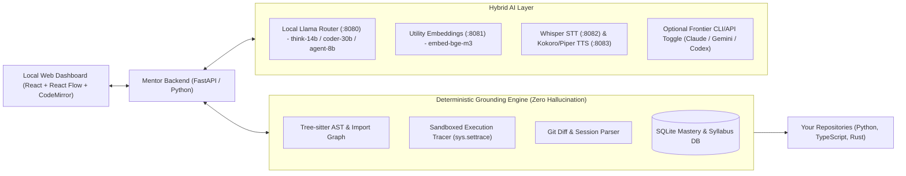

# Visual AI Code Mentor & Agentic Mastery — Blueprint Plan

> **Goal:** A custom local web application connected to your repositories and workstation AI stack that builds genuine code literacy **without typing-from-scratch friction**, teaches through interactive visual models, verifies explanations against real code execution, and turns every AI agent session into a fast, high-leverage learning loop.

---

## 1. Core Design Decisions (Locked In)

| Dimension | Chosen Design |
| :--- | :--- |
| **Delivery Format** | Purely a custom local web app (visual tutor dashboard connected to your repos) |
| **Learning Material** | "Scaffolded Bridge" starter track (tiny 15-line toy versions of your dream projects) + progressively unlocked live repos & agent diffs + on-demand concept zoom-ins |
| **Starter Language** | **Python first** (cleanest syntax, ideal for beginners and backend scripts), later transferring concepts to **TypeScript** (web/game apps) and **Rust** (systems/engine code) |
| **Visual Pillars** | 1. Interactive Architecture & Data-Flow Map 2. Code X-Ray & Agent Diff Storyboard 3. Live Execution & State Stepper 4. Agentic Prompt-to-Outcome Inspector |
| **Pedagogy & Quizzes** | Adaptive syllabus + zero-typing active quizzes (Predict Output, Spot the Agent Bug, Drag/Reorder Logic Blocks, Explain Intent in Plain English) |
| **AI Backend** | Configurable hybrid: local Llama Router (`:8080`) + embeddings (`:8081`) for fast Q&A/quizzes/RAG, with optional frontier cloud toggle (Claude/Gemini/Codex) for deep syllabus planning & tricky architecture reviews |
| **Communication** | Text + optional Voice mode using Whisper STT (`:8082`) and Kokoro/Piper TTS (`:8083`) so you can talk aloud and hear diagrams narrated |
| **Daily Rhythm** | Two-mode workflow: a **15-minute Lesson + Quiz sprint** + an on-demand **"Agent Debrief"** button whenever an agent finishes a task or commit |

---

## 2. System Architecture (Built on Your Workstation)

Your workstation already runs the hardest AI infrastructure pieces (`:8080` Llama Router, `:8081` Embeddings, `:8082` Whisper STT, `:8083` Voice TTS). The mentor web app sits cleanly on top of them as a thin local orchestration + visualization layer.

### Recommended Tech Stack
- **Backend:** Python **FastAPI** + `uvicorn`.
- **Deterministic Analysis:**
  - `tree-sitter` (Python, TypeScript, Rust) for exact symbol/call graphs.
  - Python `sys.settrace` inside a restricted subprocess for exact line-by-line variable/state snapshots.
  - `gitpython` / `git diff` CLI parsing for Agent Debriefs.
- **Persistence:** Local **SQLite** database storing your Syllabus Tree, Concept Mastery scores, Spaced-Repetition queue, and Debrief history.
- **Frontend:** **React + TypeScript + Vite**, using **React Flow** (zoomable node/data-flow maps), **Monaco or CodeMirror 6** (read-only/annotated code & diff highlighting), and Web Audio API for push-to-talk Whisper + TTS narration playback.

---

## 3. Anti-Hallucination Grounding Pipeline ("Verify First, Explain Second")

Because AI can hallucinate subtle code behavior, **the LLM is never allowed to guess structure or runtime behavior from scratch**:

1. **Structure Grounding (Maps):** Node graphs are generated 100% deterministically from `tree-sitter` imports and function call edges. The AI only generates the *plain-English summary labels* attached to real verified nodes.
2. **Execution Grounding (Stepper):** When you step through a starter lesson or mini sandbox, Python actually runs the code in a safe subprocess with `sys.settrace` and records exact `{line, locals, stack, stdout}` JSON frames. The AI narrates *real recorded frames* rather than simulating execution in its head.
3. **Diff Grounding (Debriefs):** Every "Agent Debrief" binds annotations directly to exact file paths, line numbers, and test outcomes (`pytest` / `tsc` / `cargo test` exit codes).
4. **Cross-Check Escalation:** If you click *"I'm still confused / verify this"* on a local model's explanation, one click re-evaluates the exact verified context using `think-14b` or your frontier cloud toggle.

---

## 4. The Four Core Visual Screens

### Screen 1: Interactive Architecture & Data-Flow Map
- **What you see:** A zoomable canvas of boxes (Modules -> Functions -> Data Structures) connected by directional arrows showing *what calls what* and *where data flows*.
- **Agent Overlay:** Files/functions touched by your latest agent commit glow amber/green; clicking any node opens a plain-English card: *"What is this responsible for?"* and *"What breaks if this stops working?"*
- **Voice Sync:** Clicking **"Narrate Flow"** plays Kokoro/Piper TTS explaining the path step-by-step while pulsing the corresponding nodes on screen.

### Screen 2: Code X-Ray & Agent Diff Storyboard
- **What you see:** Split-screen view. Left side: syntax-highlighted code (or green/red git diff). Right side: aligned **Plain-English Story Cards** grouped by logical intent (not just noisy per-line chatter).
- **Interactive Hover:** Hovering any variable or symbol highlights every place it is read or modified, showing its plain-English type/shape (e.g., *"ship_state: dictionary holding fuel, speed, shields"*).
- **Agent Design Decisions:** Includes a *"Why did the agent write it this way?"* box calling out trade-offs, hidden assumptions, and simpler alternatives.

### Screen 3: Live Execution & State Stepper
- **What you see:** Play / Pause / Step-Forward / Step-Back scrubber over a real execution trace.
- **Visual State Inspector:** Variables appear as live visual cards (numbers as gauges, lists as indexed rows, grids like a `3x3` voxel chunk as a visual 2D/3D table) updating in real time as the highlight bar moves line-by-line.
- **On-Demand Concept Zoom-In:** Click *"Zoom in on this concept"* on any confusing syntax in a real repo (e.g., a list comprehension or `async/await`) and the app spawns a 10-line visual stepper isolating just that mechanic.

### Screen 4: Agentic Prompt-to-Outcome Inspector
- **What you see:** A visual timeline of an agent run:
  `Your Prompt / Spec` $\rightarrow$ `Context Files Read` $\rightarrow$ `Decisions & Retries` $\rightarrow$ `Final Diff + Test Result`.
- **Agentic Coaching Card:** Diagnoses *why* an agent drifted or succeeded:
  - *"Did your prompt leave an edge case ambiguous?"*
  - *"Which exact symbol/file name could you have mentioned upfront to cut agent search time in half?"*
  - Suggests a 1-click **"Upgraded Prompt Template"** tailored to your `AGENTS.md` ticket/contract rules.

---

## 5. The "Scaffolded Bridge" Syllabus & Zero-Typing Quiz Engine

Instead of throwing Rust lifetimes or large TypeScript architectures at you on Day 1, the syllabus starts with **miniature 10–20 line Python toys inspired by real projects**, gradually unlocking real repository files.

### Tier 0: 5-Minute Visual Placement Check
- 6 quick multiple-choice "What does this snippet do?" questions (variables, `if/else`, `for` loops, lists/dicts, functions, imports).
- Marks what you already intuitively recognize so you skip boring repetition and focus straight on blind spots.

### Tier 1: Python Foundations via Mini Dream Toys (Weeks 1–3)
| Module | Core Literacy Concept | Mini Dream-Project Sandbox (10–20 lines) |
| :--- | :--- | :--- |
| **1. State & Data Shapes** | Variables, numbers, strings, dicts (`{}`), lists (`[]`) | **Mini Ship Dashboard:** Store and update fuel, hull, and cargo inventory |
| **2. Decisions & Loops** | `if/elif/else`, `for` loops, `while` loops, counters | **3x3 Grid Scanner:** Loop over a tiny 2D grid to count solid vs. empty cells |
| **3. Functions & Contracts** | Parameters, `return` values, scope (why variables stay inside functions) | **Mini Command Router:** Route a user text command to the right handler |
| **4. Connecting Multiple Files** | Imports, modules, separating "data" from "logic" | **2-File Game Tick:** Split `ship_data.py` and `physics.py` and trace data crossing the boundary |
| **5. Reading Failures & Tests** | Tracebacks, `assert`, edge cases (`None`, empty list, off-by-one) | **Spot the Broken Thruster:** Step through a failing unit test and find why shields went negative |

### Tier 2: Reading Real Agent Diffs in Python (Weeks 4–6)
- Unlocks curated, small commits and modules inside your configured **Python repositories**.
- Focuses on reading existing signatures, docstrings, Pydantic/data models, and test fixtures.

### Tier 3: Cross-Language Concept Transfer (Weeks 7+)
- **Python $\rightarrow$ TypeScript:** Side-by-side Rosetta view (*"A Python dict with type hints = a TypeScript `interface`"*), unlocking real TypeScript modules.
- **Python $\rightarrow$ Rust Concepts:** Visual memory/ownership models (*"Why Rust makes you say who owns this data chunk"*), focused purely on **reading & reviewing** Rust agent diffs accurately.

### Four Zero-Typing Quiz Mechanics
1. **Predict the Output / State:** Pause the Live Stepper right before a loop finishes or an `if` branch runs; pick what `fuel` or `grid[1][2]` will become.
2. **Spot the Agent Bug:** View a 12-line agent diff containing 1 realistic flaw (e.g., off-by-one loop, mutated shared list, missing `return`); **click the offending line**.
3. **Parsons Logic Reordering:** Drag and drop 4–6 pre-written code lines/blocks into the correct execution order (builds structural intuition with **zero syntax typing**).
4. **Explain Intent in Plain English (Voice or Short Text):** Read a function and dictate via Whisper (`:8082`) or type 1–2 sentences answering *"What problem does this function solve, and what happens if input is empty?"* The AI grades your mental model and points out any missed nuance.

---

## 6. Daily Two-Mode Workflow & Maximizing Agentic Capacity

### Mode A: Morning 15-Minute Literacy Sprint
1. **3-Min Review:** 2 spaced-repetition quiz cards from concepts you missed earlier in the week.
2. **7-Min Interactive Lesson:** 1 visual concept from your current Tier + Live Stepper walkthrough (optionally narrated via TTS).
3. **5-Min Active Quiz:** 2–3 zero-typing challenges (Predict, Spot the Bug, or Explain Intent) to unlock the next node on your Syllabus Tree.

### Mode B: On-Demand "Agent Debrief" (After Any Agent Task)
Whenever Claude, Codex, Antigravity, or `aider-local` finishes a feature or bugfix:
1. Open the dashboard and click **"Debrief Latest Commit / Session"**.
2. Review the **Architecture Map** (what changed) and **Diff Storyboard** (plain-English summary of why).
3. Answer **2 targeted micro-questions** generated from that exact diff (verifying you actually understand what just entered your codebase).
4. Read the **1 Agentic Leverage Tip** in the Prompt-to-Outcome Inspector.

### 5 Habits That Directly Boost Your Agentic Programming
1. **Learn Contracts Before Implementation:** You don't need to memorize sorting algorithms—you *do* need to read **inputs, outputs, and edge cases** (function signatures + return types).
2. **Review Tests Before Implementation Code:** Reading `tests/` in plain English tells you *what* the agent promised the code does, which is 5x easier to verify than internal implementation details.
3. **Ask Agents for Blast Radius:** Before approving big diffs, look at the Architecture Map to check how many modules a change touches.
4. **Spot Silent Assumptions:** Train your eye on the top 4 agent bugs: unvalidated empty inputs, hardcoded paths/ports, swallowed exceptions, and stale state across turns.
5. **Feed Literacy Back into Specs:** Use the vocabulary you gain from lessons (e.g., *"pure function"*, *"idempotent"*, *"early return"*, *"schema boundary"*) in your prompts and `tk new` specs—agents obey precise structural terms with dramatically higher accuracy.

---

## 7. Phased Implementation Roadmap

- **Milestone 1 — Core Skeleton & Deterministic Python Stepper:**
  FastAPI backend + React/Vite frontend + SQLite DB + `sys.settrace` sandbox runner + Live Execution & State Stepper UI.
- **Milestone 2 — Tier 0 Placement + Tier 1 Mini Toy Syllabus & Quizzes:**
  All 5 Tier 1 modules + Predict Output, Spot the Bug, Parsons Block Reorder, and Explain Intent quiz engine powered by a local or cloud LLM.
- **Milestone 3 — Repo Integration, Architecture Map & Diff Storyboard:**
  `tree-sitter` AST/import parser + React Flow interactive map + Git Diff Storyboard connected to your local repositories.
- **Milestone 4 — Voice Mode & Agentic Prompt-to-Outcome Inspector:**
  Wire Whisper STT + Kokoro/Piper TTS narration + optional frontier CLI/API escalation + Agent session/diff prompt coaching.
- **Milestone 5 — Tier 2 & Tier 3 Cross-Language Bridges:**
  TypeScript & Rust X-Ray translators and AST map support.
